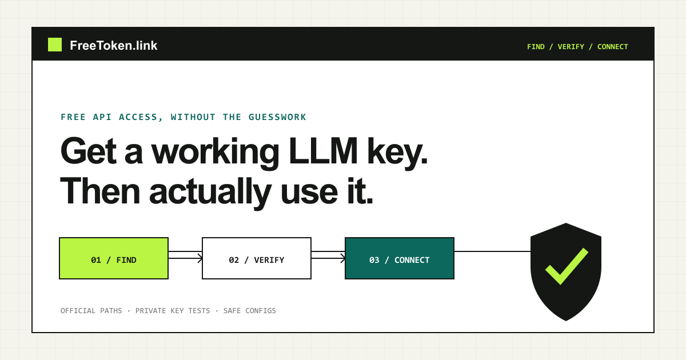

# FreeToken.link — find and verify a free-access LLM API route

[English](README.md) · [简体中文](README.zh-CN.md) · [日本語](README.ja.md) · [Español](README.es.md) · [한국어](README.ko.md)

**FreeToken.link helps developers compare dated free-access conditions, follow the official key path, verify supported routes directly in the browser, generate configuration templates that omit real keys, and build a Watchlist for material availability changes.**

Visit the live product: **[freetoken.link](https://freetoken.link/)**

> This public repository is the product documentation, launch, and feedback hub. It does not distribute the production application source, provider credentials, pooled keys, user Vault data, or operator secrets.

## Use FreeToken from an AI assistant

The read-only **FreeToken MCP server** is live and listed in the Official MCP Registry as [`link.freetoken/catalog`](https://registry.modelcontextprotocol.io/v0.1/servers/link.freetoken%2Fcatalog/versions/1.0.0), version **1.0.0**.

- Add remote server URL **`https://freetoken.link/mcp`** to a client that supports Streamable HTTP. No FreeToken account or API key is required; client setup varies.
- Search published models, read official key guides, inspect dated price references, estimate token costs, read existing sampled checks, and export keyless configurations.
- No inference, key testing, account creation, live uptime probes, or private Vault access is performed. Tool result prose is currently English; locale selects site links, not translated results.

[Connection guide](https://freetoken.link/mcp-guide) · [Tools, examples and limitations](docs/MCP.md) · [Official Registry search](https://registry.modelcontextprotocol.io/)

## Why this exists

A static “free AI API” list becomes stale quickly. A provider may change its card requirement, regional availability, quota, model ID, or application flow without changing the marketing headline.

FreeToken keeps several claims separate:

- what the provider officially documents;
- what account and region conditions may still apply;
- what FreeToken-operated Canary observations have actually tested;
- what remains unknown or unconfigured.

That separation is the product. “Listed as free” is not presented as “guaranteed to work for everyone.”

## What you can do

| Task | Live route |
| --- | --- |
| Describe the API you need | [Find by requirement](https://freetoken.link/find) |
| Filter reviewed providers and models | [Model directory](https://freetoken.link/models) |
| Follow the official key application path | [Get an API key](https://freetoken.link/get-key) |
| Diagnose an existing key safely | [Connection Doctor](https://freetoken.link/doctor) |
| Send a browser-direct test prompt | [Playground](https://freetoken.link/playground) |
| Compare compatible routes | [Compare](https://freetoken.link/compare) |
| Generate a configuration without real keys | [Config generator](https://freetoken.link/playground#tool-config) |
| Compare dated price references | [Pricing](https://freetoken.link/pricing) |
| Monitor meaningful changes | [Watchlist](https://freetoken.link/watchlist) |
| Inspect the evidence pipeline | [Source coverage](https://freetoken.link/sources) |
| Check current operational evidence | [Status](https://freetoken.link/status) |

Useful decision pages include [no-card API candidates](https://freetoken.link/find/no-credit-card), [coding and Codex candidates](https://freetoken.link/find/coding-and-codex), and [OpenAI-compatible routes](https://freetoken.link/find/openai-compatible).

## Privacy and trust boundaries

- For supported browser-direct checks, provider keys and prompts travel from the browser to the selected provider, not through a FreeToken plaintext-key proxy.
- Shared URLs never include API keys.
- Optional Vault sync stores client-encrypted ciphertext, not the passphrase or plaintext key.
- Watchlist emails require explicit consent; anonymous subscriptions use double opt-in.
- FreeToken does not distribute scraped, shared, resold, or pooled API keys.
- Community indexes may surface leads, but only provider-owned evidence can support a published access claim.

Read the full [verification model](docs/VERIFICATION.md) and [privacy boundary](docs/PRIVACY.md).

## Feedback and corrections

Found an outdated model ID, changed quota, broken official link, or incorrect access condition?

1. Open a **Source correction** issue.
2. Include the provider-owned source URL and the date you checked it.
3. Do not post API keys, tokens, account screenshots containing personal data, or private provider responses.

See [CONTRIBUTING.md](CONTRIBUTING.md) for the evidence rules.

## Public distribution

The canonical product and SEO pages remain on `https://freetoken.link/`. This repository exists for developer discovery, transparent documentation, citations, and feedback—not as a duplicate GitHub Pages website.

Platform-ready descriptions and launch notes are in [docs/LAUNCH-KIT.md](docs/LAUNCH-KIT.md). The multilingual rollout policy is in [docs/MULTILINGUAL.md](docs/MULTILINGUAL.md).

Repository owners should complete the private-reporting and label checklist in [docs/REPOSITORY-SETUP.md](docs/REPOSITORY-SETUP.md) before announcing the repository.

## Project status

FreeToken is an actively operated product. Catalog entries and availability evidence can change; inspect the dated source and current status shown on each live route before relying on a provider.

FreeToken.link is independent and is not endorsed by the listed model or API providers.
